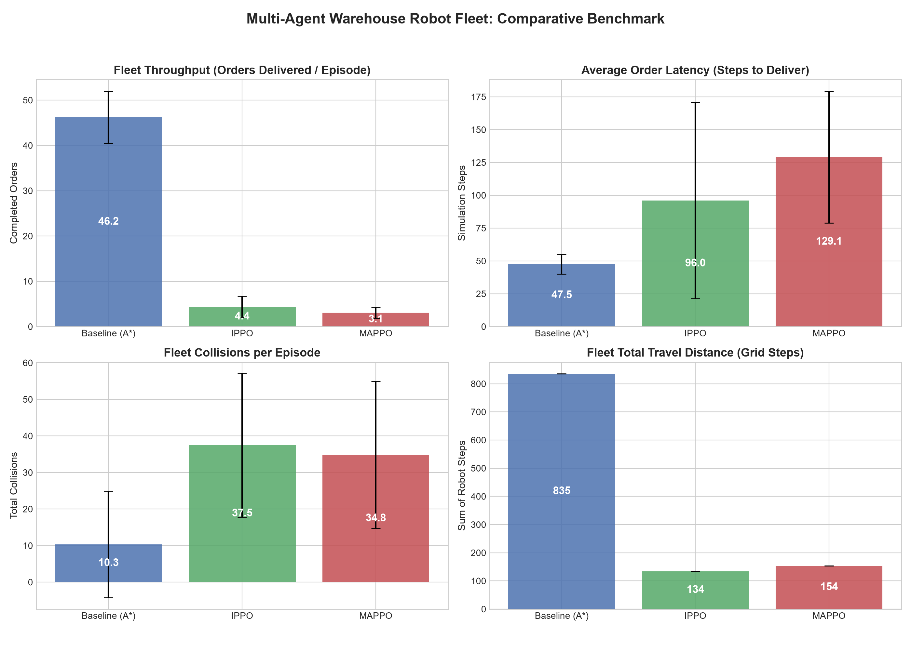
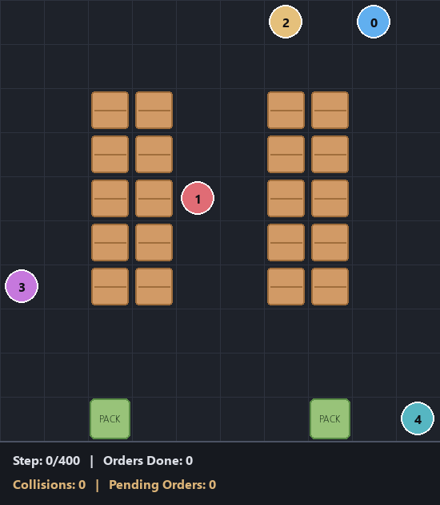

# Multi-Agent Reinforcement Learning for Autonomous Warehouse Robot Fleet Optimization

An end-to-end simulation, training, and benchmarking testbed for autonomous mobile robot (AGV/AMR) fleet coordination, order fulfillment, and collision-free routing using Multi-Agent Reinforcement Learning (MARL).

---

## 1. Project Overview

In modern automated distribution centers (e.g., Amazon Kiva, Ocado, Alibaba), fleets of autonomous mobile robots transport customer order pods between storage shelves and packing workstations. Operating multiple robots in shared narrow corridors gives rise to traffic congestion, deadlocks, and spatial contention.

This project implements and compares three decision-making paradigms:
1. **Classical Industrial Heuristic Baseline**: Greedy Nearest-Robot Allocation + Collision-Aware Space-Time $A^*$ Pathfinding with a dynamic 4D Reservation Table.
2. **Decentralized Single-Agent RL (IPPO)**: Independent Proximal Policy Optimization with parameter sharing across robots.
3. **Multi-Agent Reinforcement Learning (MAPPO)**: Centralized Training with Decentralized Execution (CTDE), pairing decentralized actors with a centralized value function that evaluates global warehouse congestion.

---

## 2. Key Architecture & RL Formulation

```text
warehouse-rl/
├── environment/
│   ├── grid.py                 # 2D Warehouse floor layout, shelves, stations, obstacles
│   ├── robot.py                # AMR physical state machine & metrics tracking
│   ├── order.py                # Poisson arrival stream with Pareto 80/20 SKU skew
│   ├── warehouse_env.py        # PettingZoo ParallelEnv compliant environment
│   └── gym_wrapper.py          # Gymnasium vectorized interface
│
├── baselines/
│   ├── astar.py                # Space-Time A* pathfinding with 3D reservation table
│   └── heuristic_agent.py      # Greedy task allocator + Space-Time A* navigator
│
├── agents/
│   ├── models.py               # Actor, DecentralizedCritic, and CentralizedCritic networks
│   ├── ippo_agent.py           # Independent PPO algorithm
│   └── mappo_agent.py          # Multi-Agent PPO with CTDE
│
├── training/
│   ├── buffer.py               # Multi-agent rollout buffer with GAE
│   ├── train_ippo.py           # IPPO training pipeline with TensorBoard logging
│   └── train_mappo.py          # MAPPO training pipeline with TensorBoard logging
│
├── evaluation/
│   ├── metrics.py              # Statistical metrics tracker (latency, throughput, collisions)
│   └── evaluate.py             # Head-to-head benchmarking runner
│
├── visualization/
│   ├── renderer.py             # Real-time Pygame 2D simulation visualizer
│   └── plotter.py              # Matplotlib publication-grade comparative dashboard
│
├── configs/
│   └── default_config.yaml     # Centralized hyperparameters & environment settings
│
├── results/                    # Saved model weights (.pt), logs, CSVs, and plots
├── demo.py                     # Interactive visual demo launcher
├── requirements.txt            # Frozen package dependencies
└── README.md
```

### Observation Space ($o_i \in \mathbb{R}^{28}$)
Each robot receives an egocentric, normalized observation vector:
- **Self Status (6 dims)**: Normalized coordinates $(x/W, y/H)$, status flag (`IDLE`, `EN_ROUTE`, `CARRYING`), target coordinates $(x_t/W, y_t/H)$, and normalized distance to goal.
- **Local Obstacle Raycasts (4 dims)**: Immediate impassable cell indicators in 4 cardinal directions $[N, S, E, W] \in \{0, 1\}$.
- **Neighbor Robot Offsets (12 dims)**: Relative positions $(\Delta x / W, \Delta y / H)$, carrying status, and proximity alerts for the 3 closest neighboring robots.
- **Target Direction Vector (2 dims)**: Unit heading $(\cos \theta, \sin \theta)$ toward active target.
- **Nearest Packing Station (2 dims)**: Relative offset to closest delivery workstation.
- **Congestion Gauge (2 dims)**: Number of robots within 2-cell radius and consecutive wait step counter.

### Action Space ($\mathcal{A}_i \in \{0, 1, 2, 3, 4, 5\}$)
- `0`: Move North ($y - 1$)
- `1`: Move South ($y + 1$)
- `2`: Move East ($x + 1$)
- `3`: Move West ($x - 1$)
- `4`: Wait / Yield (Stand still)
- `5`: Interact (Load item at shelf access cell / Unload item at packing station)

### Reward Function
$$\mathcal{R}_i(t) = R_{\text{delivery}} + R_{\text{pickup}} + R_{\text{progress}} + R_{\text{collision}} + R_{\text{time}} + R_{\text{wait\_idle}}$$
- $R_{\text{delivery}} = +10.0$: Successfully delivering an order pod to a packing workstation.
- $R_{\text{pickup}} = +3.0$: Successfully loading item from target shelf pod.
- $R_{\text{progress}} = 0.2 \times (d_t - d_{t+1})$: Potential-based reward shaping for progress toward target.
- $R_{\text{collision}} = -5.0$: Penalty for robot-robot or obstacle collisions.
- $R_{\text{time}} = -0.02$: Step cost to encourage shortest-time routing.
- $R_{\text{wait\_idle}} = -0.05$: Penalty for stalling when an active target is assigned.

---

## 3. Quickstart & Installation

### Setup Environment
```bash
# Clone the repository
cd warehouse-rl

# Activate existing virtual environment or create a new one
python -m venv venv
.\venv\Scripts\activate  # On Windows

# Install dependencies
pip install -r requirements.txt
```

### Run Unit Tests
```bash
python -m pytest tests/
```

---

## 4. How to Train RL & MARL Agents

### Train Independent PPO (IPPO)
```bash
python training/train_ippo.py --timesteps 20000 --seed 42
```

### Train Multi-Agent PPO (MAPPO) with Centralized Critic
```bash
python training/train_mappo.py --timesteps 20000 --seed 42
```

TensorBoard logs are saved to `results/logs/`. To monitor training live:
```bash
tensorboard --logdir results/logs/
```

---

## 5. Running the Comparative Benchmark

Run all three methods across identical evaluation seeds:
```bash
python evaluation/evaluate.py --episodes 10 --order_lambda 0.25
```

This generates `results/evaluation_results.csv`.

To generate publication-grade comparison plots:
```bash
python visualization/plotter.py --csv results/evaluation_results.csv
```



---

## 6. Live Interactive Simulation

Launch the Pygame warehouse visualizer in real-time:

```bash
# Run Heuristic Space-Time A* Baseline
python demo.py --method baseline --fps 15

# Run Trained IPPO Fleet
python demo.py --method ippo --fps 15

# Run Trained MAPPO Fleet
python demo.py --method mappo --fps 15
```



---

## 7. Research Questions & Theoretical Insights

1. **Why is this an RL problem?**
   Classical exact planning methods (such as Conflict-Based Search - CBS) suffer exponential worst-case computational complexity $\mathcal{O}(2^N)$ in dynamic environments where orders arrive stochastically. RL pre-computes coordination heuristics during offline training, providing sub-millisecond execution time during live deployment.

2. **Why is Multi-Agent RL (MAPPO) superior to Independent RL (IPPO)?**
   In IPPO, each robot views other learning agents as moving parts of the environment. This causes severe non-stationarity, violating the Markov property. MAPPO solves this through Centralized Training with Decentralized Execution (CTDE): the centralized critic observes global warehouse traffic and queue backlog, stabilizing value estimates and resolving the multi-agent credit assignment problem.

3. **Why isn't single-agent shortest path (Standard A*) sufficient?**
   Standard single-agent $A^*$ ignores time and other agents, causing head-on deadlocks and severe gridlock at intersections. Space-Time $A^*$ with a reservation table improves safety but can still suffer starvation or deadlock when multiple agents converge on the same workstation.

4. **Limitations & Future Work**:
   - Discrete grid assumptions: Future extensions can integrate continuous kinematics and acceleration curves.
   - Battery charging dynamics: Adding charging stations and energy depletion thresholds.
   - Fleet scaling: Hierarchical MARL for fleets of $50+$ robots.
